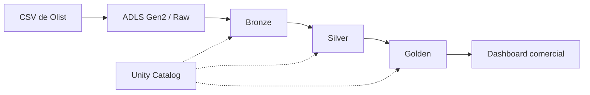

# Proyecto comercial Olist con Azure Databricks

En este proyecto trabajé con los datos públicos de Olist, una plataforma de comercio electrónico de Brasil. El objetivo fue construir un proceso de ingeniería de datos que partiera de los archivos originales, los transformara en Databricks y dejara un modelo de datos preparado para analizar ventas, pedidos, clientes y productos.

El trabajo incluye la carga y transformación con PySpark, almacenamiento en Azure Data Lake Storage Gen2, tablas Delta administradas mediante Unity Catalog, un dashboard comercial y el despliegue a producción desde GitHub Actions.

## Datos utilizados

La fuente es el [Brazilian E-Commerce Public Dataset by Olist](https://www.kaggle.com/datasets/olistbr/brazilian-ecommerce), disponible en Kaggle. Se utilizaron sus nueve archivos CSV, con información de pedidos, artículos, clientes, productos, vendedores, pagos, reseñas, ubicaciones y categorías.

Los archivos se cargaron en el contenedor `raw` de la cuenta de almacenamiento `adlsmartdata08100`. Databricks accede a ellos mediante una identidad administrada de Azure y una ubicación externa configurada en Unity Catalog.

Los datos originales no están incluidos en el repositorio. El detalle de las fuentes, campos y cantidades de registros se encuentra en [datasets/README.md](datasets/README.md).

## Arquitectura y procesamiento

El proceso sigue una arquitectura de tres capas. Los datos originales permanecen en Raw y las tablas de trabajo se almacenan en formato Delta.

En **Bronze** se cargan los nueve archivos de origen. En **Silver** se realizan las conversiones de tipos, la limpieza y la preparación de las entidades que después se utilizarán en el análisis. En **Golden** se construye el modelo dimensional con ocho dimensiones y cuatro tablas de hechos.

| Capa | Tablas | Contenido |
|---|---:|---|
| Bronze | 9 | Información procedente de los CSV |
| Silver | 9 | Pedidos, ventas, clientes, productos, vendedores, pagos, reseñas, ubicaciones y categorías |
| Golden | 12 | 8 dimensiones y 4 tablas de hechos |

Las dimensiones son `dim_fecha`, `dim_cliente`, `dim_producto`, `dim_categoria`, `dim_vendedor`, `dim_geografia`, `dim_metodo_pago` y `dim_estado_pedido`. Las tablas de hechos son `fact_ventas`, `fact_pedidos`, `fact_pagos` y `fact_resenas`.

Se mantuvo la granularidad de cada tabla: por ejemplo, `fact_ventas` contiene el detalle por artículo, mientras que `fact_pedidos` contiene una fila por pedido. Esto permite calcular indicadores sin duplicar importes al combinar información de distintos niveles.

## Ambientes de trabajo

El desarrollo se realizó en dos workspaces de Databricks:

| Ambiente | Workspace | Catálogo |
|---|---|---|
| Desarrollo | `adb-tf-comercial-dev` | `catalog_dev` |
| Producción | `adb-tf-comercial-prod` | `catalog_prod` |

Las tablas también se separaron físicamente por ambiente en ADLS Gen2, utilizando las rutas `/dev/` y `/prod/` en los contenedores de Bronze, Silver y Golden.

Los notebooks aceptan el parámetro `catalogo`, de modo que el mismo procesamiento puede ejecutarse sobre uno u otro catálogo sin cambiar las consultas manualmente.

## Ejecución del ETL y despliegue

Los notebooks están en la carpeta [`proceso/`](proceso/) y se ejecutan en este orden:

1. `1.Preparacion_Ambiente.ipynb`: preparación del catálogo, esquemas y tablas.
2. `2.Ingest_Bronze.ipynb`: lectura de los nueve CSV y carga a Bronze.
3. `3.Transform_Silver.ipynb`: limpieza y transformación de los datos.
4. `4.Transform_Golden_Dimensiones.ipynb`: construcción de las ocho dimensiones.
5. `5.Transform_Golden_Hechos.ipynb`: construcción de las cuatro tablas de hechos.
6. `6.Validacion_Modelo_KPIs.ipynb`: revisión de tablas, relaciones e indicadores.
7. `7.Grants_Medallion.ipynb`: configuración de permisos.

Para el despliegue utilicé [GitHub Actions](.github/workflows/deploy-olist.yml). Cuando se actualizan los notebooks de `proceso/` o el archivo del workflow en la rama `main`, la automatización importa los notebooks en el workspace de producción, actualiza el job `WF_OLIST_PROD` y ejecuta las tareas en secuencia con `catalogo=catalog_prod`.

El 13 de noviembre de 2026 se realizó una ejecución completa en producción. Las siete tareas finalizaron correctamente en **5 minutos y 21 segundos**, y el catálogo de producción quedó con **30 tablas Delta**: 9 Bronze, 9 Silver y 12 Golden.

El job tiene su programación automática en pausa. Para este proyecto se ejecutó durante el despliegue, sin necesidad de mantener el clúster encendido permanentemente.

## Dashboard comercial

El dashboard se desarrolló con Databricks AI/BI Dashboards y está exportado en [`dashboard/BI_Comercial_Olist_DEV.lvdash.json`](dashboard/BI_Comercial_Olist_DEV.lvdash.json).

### Resumen ejecutivo

La primera página muestra indicadores generales de la operación y gráficos de evolución mensual. Los valores del histórico son:

| Indicador | Valor |
|---|---:|
| Ingresos por productos | R$ 13.591.643,70 |
| Pedidos | 99.441 |
| Clientes únicos | 96.096 |
| Ticket promedio | R$ 137,75 |

Los ingresos corresponden a los productos vendidos, sin incluir el flete. Los gráficos mensuales se concentran en el período de enero de 2017 a agosto de 2018; las tarjetas superiores muestran los datos del histórico completo.

### Productos y categorías

La segunda página permite comparar las diez categorías con mayores ingresos, la cantidad de artículos vendidos y el precio promedio de cada categoría.

El JSON conserva las consultas y visualizaciones de ambas páginas. Las consultas del dashboard hacen referencia a `catalog_dev`, que fue el ambiente utilizado para construirlo.

## Seguridad y validaciones

El acceso al almacenamiento se configuró con Managed Identity y External Locations. En Unity Catalog se definieron permisos para dos grupos: `grp_olist_ingenieria`, con acceso de trabajo sobre las capas, y `grp_olist_analistas`, con permisos de lectura sobre Golden.

Durante el procesamiento se incorporaron validaciones de cantidad de registros, claves, relaciones entre entidades y conciliación de indicadores. También se incluyó una revisión de permisos con `SHOW GRANTS`.

La carpeta [`reversion/`](reversion/) contiene una simulación del procedimiento de contingencia. No ejecuta eliminaciones de las tablas de producción ni representa una restauración automática. Para recuperar una versión anterior del código se puede utilizar el historial de Git; para los datos, la estrategia dependería del historial Delta disponible o de una nueva ejecución desde Raw.

## Archivos del repositorio

- [`PrepAmb/`](PrepAmb/): notebook de preparación del ambiente de desarrollo.
- [`proceso/`](proceso/): notebooks del ETL y la validación.
- [`seguridad/`](seguridad/): configuración de permisos en Unity Catalog.
- [`reversion/`](reversion/): simulación del procedimiento de contingencia.
- [`datasets/`](datasets/): descripción de los archivos de origen.
- [`dashboard/`](dashboard/): exportación del dashboard en JSON.
- [`evidencias/`](evidencias/): capturas del desarrollo y de los resultados.
- [`.github/workflows/deploy-olist.yml`](.github/workflows/deploy-olist.yml): automatización del despliegue a producción.

El repositorio contiene el código y las evidencias del trabajo. Las credenciales de conexión se gestionaron con GitHub Actions Secrets y no forman parte de los archivos publicados.
