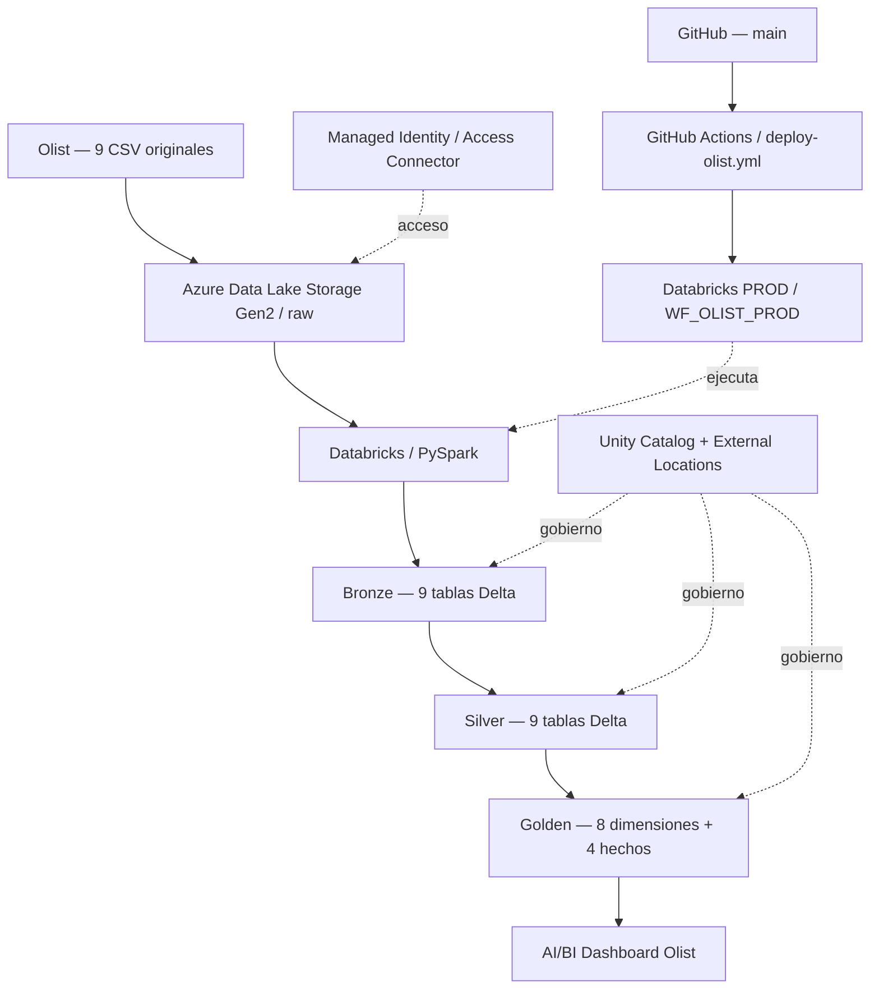

# Proyecto comercial Olist — Ingeniería de Datos con Azure Databricks

**Pipeline ETL end-to-end con arquitectura medallion (Raw → Bronze → Silver → Golden), Unity Catalog, Azure Data Lake Storage Gen2, PySpark, modelo dimensional, dashboard y CI/CD con GitHub Actions.**

  

> **Resultado verificado:** el workflow `WF_OLIST_PROD` completó sus siete tareas con estado **Succeeded** y se confirmó en el explorador de Unity Catalog la existencia de **9 tablas Bronze, 9 Silver y 12 Golden** dentro de `catalog_prod`. La ejecución observada duró **5 min 21 s** (13 de noviembre de 2026, según la interfaz de Databricks). El resultado de GitHub Actions también fue exitoso.

## 1. Objetivo

Diseñar e implementar una solución reproducible de ingeniería de datos para analizar la actividad comercial de **Olist**, un conjunto público de comercio electrónico brasileño. El flujo integra nueve CSV de origen, aplica transformaciones con **PySpark**, organiza los resultados en Delta Lake y proporciona hechos y dimensiones para evaluar ventas, pedidos, clientes, productos, vendedores, pagos y satisfacción.

**Objetivos técnicos:**

- Conectar Databricks al origen Raw en ADLS Gen2 mediante **Managed Identity**, sin usar DBFS ni Volumes como fuente Raw.
- Separar datos crudos, depurados y analíticos mediante las capas **Bronze, Silver y Golden**.
- Crear y gobernar tablas externas Delta usando **Unity Catalog**.
- Parametrizar los notebooks para ejecutar el mismo ETL en `catalog_dev` y `catalog_prod`.
- Automatizar el despliegue, el workflow y su monitoreo mediante **GitHub Actions**.
- Construir una primera visualización ejecutiva en Databricks AI/BI Dashboards.

## 2. Arquitectura



**Infraestructura utilizada**

| Componente | Implementación |
|---|---|
| Workspace DEV | `adb-tf-comercial-dev` |
| Workspace PROD | `adb-tf-comercial-prod` |
| Cuenta de almacenamiento | `adlsmartdata08100` |
| Contenedores ADLS Gen2 | `raw`, `bronze`, `silver`, `golden`, `metastore` |
| Catálogos Unity Catalog | `catalog_dev`, `catalog_prod` |
| Identidad para acceso al almacenamiento | Azure Access Connector con Managed Identity |
| Clúster de ejecución PROD | `cluster_olist_prod`, Databricks Runtime 16.4 LTS |
| Workflow PROD | `WF_OLIST_PROD` |
| Dashboard inicial | `BI_Comercial_Olist_DEV` |

La ruta de Raw tiene la forma `abfss://raw@adlsmartdata08100.dfs.core.windows.net/` y los CSV están en su raíz. Las rutas físicas Delta se mantienen segregadas por ambiente: por ejemplo, `abfss://silver@adlsmartdata08100.dfs.core.windows.net/dev/pedidos` y `.../prod/pedidos`.

## 3. Datos de entrada

**Origen:** [Brazilian E-Commerce Public Dataset by Olist — Kaggle](https://www.kaggle.com/datasets/olistbr/brazilian-ecommerce).

| Archivo CSV | Registros leídos | Tabla Bronze |
|---|---:|---|
| `olist_orders_dataset.csv` | 99.441 | `orders` |
| `olist_order_items_dataset.csv` | 112.650 | `order_items` |
| `olist_customers_dataset.csv` | 99.441 | `customers` |
| `olist_products_dataset.csv` | 32.951 | `products` |
| `olist_sellers_dataset.csv` | 3.095 | `sellers` |
| `olist_order_payments_dataset.csv` | 103.886 | `order_payments` |
| `olist_order_reviews_dataset.csv` | 99.224 | `order_reviews` |
| `olist_geolocation_dataset.csv` | 1.000.163 | `geolocation` |
| `product_category_name_translation.csv` | 71 | `category_translation` |
| **Total** | **1.550.922** | **9 fuentes** |

Los conteos son los verificados en la ingesta del proyecto; representan filas de cada archivo, **no compradores ni transacciones únicas**. El dataset y sus relaciones se describen con mayor detalle en [`datasets/README.md`](datasets/README.md). Los archivos originales permanecen en Azure Data Lake, sin duplicarse en este repositorio.

## 4. Diseño de datos: arquitectura medallion

### Bronze — 9 tablas

`orders`, `order_items`, `customers`, `products`, `sellers`, `order_payments`, `order_reviews`, `geolocation`, `category_translation`.

Se leen los CSV de Raw utilizando los esquemas Delta definidos previamente y se validan sus volúmenes antes de escribir. La carga utiliza rutas externas con separación por ambiente.

### Silver — 9 tablas

`pedidos`, `detalle_ventas`, `clientes`, `productos`, `vendedores`, `pagos`, `resenas`, `ubicaciones`, `categorias`.

La capa incorpora tipificación, limpieza y estandarización de campos. La fuente geográfica se consolida por prefijo postal para evitar multiplicaciones de filas en las uniones analíticas. Se distingue `customer_id` (cliente asociado al pedido) de `customer_unique_id` (comprador recurrente).

### Golden — 12 tablas: 8 dimensiones y 4 hechos

| Tabla | Rol / granularidad |
|---|---|
| `dim_fecha` | Calendario analítico, clave `id_fecha` |
| `dim_cliente` | Comprador único, clave `id_cliente_unico` |
| `dim_producto` | Atributos de producto |
| `dim_categoria` | Categoría y traducción |
| `dim_vendedor` | Vendedor |
| `dim_geografia` | Ubicación por código postal |
| `dim_metodo_pago` | Medio de pago |
| `dim_estado_pedido` | Estado del pedido |
| `fact_ventas` | Una fila por artículo de pedido: (`id_pedido`, `id_item`) |
| `fact_pedidos` | Una fila por pedido: `id_pedido` |
| `fact_pagos` | Una fila por pago: (`id_pedido`, `secuencia_pago`) |
| `fact_resenas` | Una fila por reseña asociada a pedido: (`id_resena`, `id_pedido`) |

El resultado es un **modelo dimensional de hechos compartiendo dimensiones (constelación de hechos)**. Los hechos no deben unirse directamente entre sí a nivel de detalle cuando la cardinalidad provoque duplicidades: por ejemplo, `fact_pagos` y `fact_ventas` tienen granularidades distintas.

## 5. Indicadores y resultados

Valores históricos validados en el dashboard y el ETL:

| Indicador | Resultado | Definición |
|---|---:|---|
| Ingresos de productos | **R$ 13.591.643,70** | Suma de `importe_articulos`; sin flete |
| Pedidos registrados | **99.441** | Conteo de `fact_pedidos` |
| Clientes únicos | **96.096** | Distintos `id_cliente_unico` |
| Ticket promedio | **R$ 137,75** | Ingresos de productos / pedidos con detalle de venta |

**Aclaraciones analíticas:** los ingresos de productos no son necesariamente equivalentes a los pagos recibidos; tampoco incluyen el flete. El ticket medio no se calcula dividiendo entre líneas de pedido. La métrica `entrega_a_tiempo` solo es interpretable cuando existe una entrega efectiva. Para crecimientos mensuales se excluyeron comparaciones de baja actividad y se acotó la visualización principal a enero de 2017–agosto de 2018, sin borrar registros de origen.

### Dashboard

Archivo exportado: [`dashboard/BI_Comercial_Olist_DEV.lvdash.json`](dashboard/BI_Comercial_Olist_DEV.lvdash.json).

La versión entregada incluye una página **`01. Resumen Ejecutivo`** con cuatro tarjetas KPI y tres gráficos: evolución mensual de ingresos, evolución del ticket promedio mensual y crecimiento mensual de ingresos. Las **tarjetas resumen muestran el histórico completo**; los gráficos mensuales usan el rango de análisis descrito arriba. Antes de implementar filtros compartidos, no se deben interpretar ambos bloques como si siempre representaran el mismo período.

## 6. Ejecución en DEV y PROD

| Ambiente | Catálogo | Ubicación física de las capas |
|---|---|---|
| DEV | `catalog_dev` | `bronze/dev`, `silver/dev`, `golden/dev` |
| PROD | `catalog_prod` | `bronze/prod`, `silver/prod`, `golden/prod` |

Los notebooks reciben el parámetro `catalogo`. En producción el workflow envía **`catalogo=catalog_prod`**, en lugar de utilizar el valor predeterminado de desarrollo.

**Orden de ejecución del workflow** (`proceso/`):

1. `1.Preparacion_Ambiente.ipynb` — catálogo, esquemas, ubicaciones y DDL.
2. `2.Ingest_Bronze.ipynb` — carga de nueve CSV a Bronze.
3. `3.Transform_Silver.ipynb` — tipificación y transformación a Silver.
4. `4.Transform_Golden_Dimensiones.ipynb` — ocho dimensiones.
5. `5.Transform_Golden_Hechos.ipynb` — cuatro tablas de hechos.
6. `6.Validacion_Modelo_KPIs.ipynb` — conciliaciones y controles de calidad.
7. `7.Grants_Medallion.ipynb` — permisos de Unity Catalog.

**Primera ejecución PROD:** el workflow `WF_OLIST_PROD` finalizó correctamente con **7/7 tareas exitosas** y duración **5 min 21 s**. Unity Catalog mostró **30 tablas en producción** (9/9/12). Los 30 objetos verificados corresponden a sus tablas; las cifras de linaje de Databricks son métricas distintas y no sustituyen la comprobación del inventario.

## 7. GitHub Actions: CI/CD

Workflow: [`.github/workflows/deploy-olist.yml`](.github/workflows/deploy-olist.yml).

- Disparador automático al publicar cambios en `main` que afecten `proceso/**` o el propio YAML; también admite ejecución manual.
- Verificación de la estructura de notebooks y conexión a las APIs de Databricks.
- Despliegue de los **siete notebooks** en el workspace PROD.
- Obtención del clúster `cluster_olist_prod` y creación/actualización del job `WF_OLIST_PROD`.
- Definición de dependencias secuenciales, envío del parámetro `catalogo=catalog_prod` y lanzamiento del job.
- Seguimiento de la ejecución hasta su resultado final, con error del pipeline si una tarea falla.

El clúster es existente y se controla su apagado para evitar consumos innecesarios. La programación incorporada al job queda **en pausa** por defecto; la ejecución inicial se realizó desde el proceso de despliegue. No se requiere mantener un clúster encendido permanentemente.

**Secrets utilizados (solo nombres; nunca valores):** `DATABRICKS_ORIGIN_HOST`, `DATABRICKS_ORIGIN_TOKEN`, `DATABRICKS_DEST_HOST`, `DATABRICKS_DEST_TOKEN`. Se almacenan en GitHub Actions Secrets y no deben copiarse a archivos versionados.

## 8. Seguridad y gobernanza

Se utiliza Unity Catalog con identidades y grupos de nivel cuenta:

| Grupo | DEV: permisos configurados |
|---|---|
| `grp_olist_ingenieria` | `USE CATALOG`; `USE SCHEMA`, `SELECT`, `MODIFY`, `CREATE TABLE` sobre Bronze, Silver y Golden |
| `grp_olist_analistas` | `USE CATALOG`; `USE SCHEMA`, `SELECT` sobre Golden |

Los permisos DEV fueron verificados mediante `SHOW GRANTS`. Existe un notebook de grants específico dentro del workflow de PROD. **La prueba de permisos mediante sesiones de usuarios de cada grupo es independiente de la comprobación de los GRANT y no se presenta aquí como realizada.**

Se utiliza **Managed Identity / External Locations** para leer Raw; no se publican secretos ni claves de ADLS. No copiar los ejemplos didácticos de autenticación con secretos incrustados al repositorio final.

## 9. Validación y controles

- Comparación del número de filas de cada CSV respecto al volumen esperado.
- Verificación de tablas Bronze, Silver y Golden.
- Control de unicidad de claves de hechos y dimensiones.
- Conciliación de importes entre líneas de artículos y pedidos.
- Validación de relaciones entre pedidos, clientes, artículos, vendedores y productos.
- Verificación de KPIs del dashboard a partir de las tablas Golden.
- Comprobación de la ejecución secuencial de los siete notebooks en PROD.

**Estado demostrado en PROD:** ejecución exitosa del workflow y existencia de las 30 tablas en Unity Catalog. Para auditorías adicionales pueden revisarse las salidas de la tarea `validacion` y los recuentos de cada tabla.

## 10. Reversión y recuperación

La carpeta [`reversion/`](reversion/) documenta un **plan de contingencia desactivado por defecto**. Distinguir entre:

1. **Limpieza de un primer despliegue fallido:** identificar los objetos creados exclusivamente por ese despliegue y retirarlos de manera controlada.
2. **Regresar a una versión anterior del código:** recuperar el commit estable desde Git y redeplegar.
3. **Recuperar datos Delta:** consultar `DESCRIBE HISTORY` y restaurar una versión anterior únicamente si los archivos y las versiones necesarias siguen disponibles.
4. **Reconstrucción total:** volver a preparar las tablas y ejecutar el ETL desde los CSV originales de Raw cuando una restauración no sea aplicable.

**Advertencia:** el notebook actual de reversión se mantiene en modo simulación. No equivale a un mecanismo de restauración automática ni se debe ejecutar una eliminación indiscriminada de las 30 tablas existentes en PROD.

## 11. Organización del repositorio

```text
proyecto-comercial-databricks/
├── .github/
│   └── workflows/
│       └── deploy-olist.yml
├── PrepAmb/                 # Preparación y DDL de referencia en DEV
├── proceso/                 # Siete notebooks desplegados y ejecutados en PROD
├── seguridad/               # Configuración de grants DEV
├── reversion/               # Plan de contingencia seguro
├── datasets/                # Documentación de fuentes Olist
│   └── README.md
├── dashboard/               # Dashboard AI/BI exportado en JSON
├── evidencias/              # Arquitectura y capturas reales de ejecución
├── certificaciones/         # Certificaciones verificables, si se aportan
└── README.md                # Documento principal del proyecto
```

## 12. Evidencias y verificación de la entrega

- **Arquitectura:** [`evidencias/arquitectura_olist.png`](evidencias/arquitectura_olist.png) — diagrama de referencia. Si ese archivo no se ha subido aún, incorporarlo a la rama `main`.
- **GitHub Actions:** adjuntar captura real de la ejecución exitosa.
- **Databricks workflow PROD:** adjuntar captura del gráfico de las siete tareas en verde y de la duración.
- **Unity Catalog PROD:** adjuntar capturas de los esquemas Bronze (9), Silver (9) y Golden (12).
- **Dashboard:** adjuntar captura real de `01. Resumen Ejecutivo`.
- **Lineage (opcional):** adjuntar el linaje capturado por Unity Catalog.

Las capturas deben corresponder a ejecuciones reales y guardarse en `evidencias/`. No es necesario incluir tokens, accesos privados ni pantallas con secretos. Completar o actualizar aquí los enlaces a las imágenes según los nombres definitivos cargados.


## Dashboard comercial Olist

El dashboard fue desarrollado en Azure Databricks AI/BI
y comprende dos páginas de análisis comercial.

### 01. Resumen Ejecutivo

Incluye ingresos totales, pedidos, clientes únicos,
ticket promedio y evolución mensual de indicadores.


### 02. Productos y Categorías

Presenta el ranking de categorías por ingresos,
artículos vendidos y precios promedio.


---

**Entregable final:** repositorio público [CristianOmarHZ/proyecto-comercial-databricks](https://github.com/CristianOmarHZ/proyecto-comercial-databricks). El historial de la rama `main`, la ejecución de GitHub Actions y el job `WF_OLIST_PROD` constituyen la trazabilidad del despliegue presentado.
